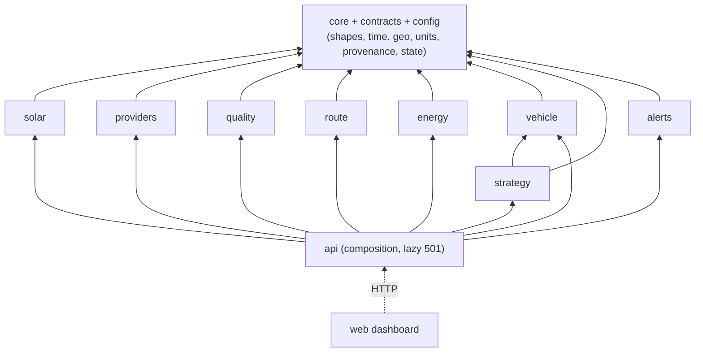
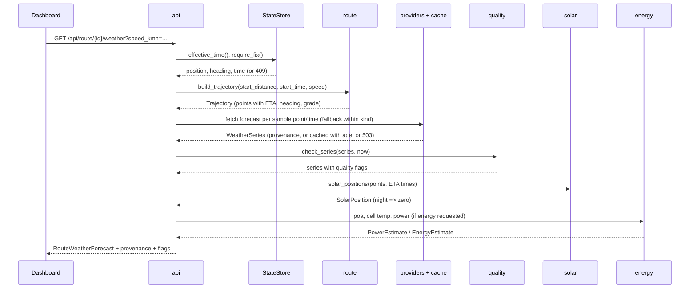

# JST-RWI architecture

Scope: the architecture of what is being built for BWSC 2027 (Darwin to Adelaide, 22-29 August 2027).
Written 2026-11-01. Sections 1-9 describe the architecture **as contracted** (`docs/CONTRACTS.md`,
`src/rwi/contracts.py`, `src/rwi/core/`). Implementation status is stated separately in section 12
and in `docs/REQUIREMENTS.md`, and is based on files that existed on disk when checked. Several modules
are being written in parallel and change daily; where this document says "contracted", the code may not
exist yet.

Related: `docs/adr/` (decisions), `docs/research/bwsc-2027-regulations.md` (constraints),
`docs/research/data-sources.md` (licences), `docs/science/` (methods per module).

## 1. What the system is for

JST-RWI turns weather and position into decision support for human race strategists:

1. where the vehicle is, and when (one authoritative state);
2. what the atmosphere is doing there (observations) and will do (forecasts), each labelled for what it is;
3. how much solar power and energy the array can collect (physical models, not guesses);
4. what the weather will be at the places and times the vehicle is **predicted to be** (trajectory-aware);
5. how candidate driving scenarios compare in energy, time and risk, within legal and physical limits.

It recommends. It does not command the vehicle (master specification section 3; Regulations 2.26 on
automatic functions are a reminder of why).

## 2. Architectural principles

| Principle | Where it is enforced |
|---|---|
| One authoritative position and time; no hidden default location | `rwi.core.position.ActiveState`, `rwi.core.state.StateStore`; `PositionUnavailableError` instead of a default |
| UTC internally, local time derived from the active position | `rwi.core.timebase` (naive datetimes rejected) |
| Every number carries provenance and a kind (observation, forecast, clear-sky, ...) | `rwi.core.provenance`, `Measured`, `Provenance` |
| Canonical units, conversion only at the boundary | `rwi.core.variables` (registry), `rwi.core.units` |
| Physical invariants enforced at construction | validators in `contracts.py` (for example irradiance is zero when the Sun is below the horizon) |
| A forecast is never an observation; stale never looks fresh | ADR 0004; `QualityFlag.STALE`; `Provenance.age_s` |
| Modules are independent and talk through contracts | ADR 0005 |
| Honest absence: a missing capability answers "not available" | `rwi.api.capability` returns HTTP 501 naming the module |
| Decision support only | no endpoint issues vehicle commands |

## 3. Module map and dependency direction

### 3.1 Responsibilities

| Layer | Module | Responsibility | May depend on |
|---|---|---|---|
| 0 | `rwi.core` | Primitives: `GeoPoint`, geodesy (pyproj), time base and time zones, units, canonical variable registry, wind vectors and relative wind, `Provenance`/`Measured`, errors, `PositionFix`/`ActiveState`/`StateStore` | stdlib, pydantic, pyproj, timezonefinder |
| 0 | `rwi.contracts` | Every type that crosses a module boundary (solar, weather, provider protocol, route, trajectory, PV, vehicle, scenario, recommendation, alert) | `core` only |
| 0 | `rwi.config` | Environment-driven settings, no secrets in source | pydantic-settings |
| 1 | `rwi.solar` | Solar position, day events, clear-sky irradiance, GHI decomposition (pvlib) | `core`, `contracts` |
| 1 | `rwi.providers` | Weather source adapters, capabilities, retry/backoff, cache hooks, fallback within a kind | `core`, `contracts`, `config` |
| 1 | `rwi.quality` | Range, rate-of-change, freshness checks; flags, never deletes | `core`, `contracts` |
| 1 | `rwi.route` | Route load (GeoJSON/GPX), projection (map matching), distance-to-point, trajectory with ETA, control stops, daily window | `core`, `contracts` |
| 1 | `rwi.energy` | POA transposition, cell temperature, array power, energy integration, comparison with measurements | `core`, `contracts` |
| 1 | `rwi.vehicle` | Longitudinal dynamics: aerodynamic, rolling, gradient, auxiliary power with relative wind | `core`, `contracts` |
| 2 | `rwi.strategy` | Segments, scenario evaluation and comparison, recommendation with assumptions and uncertainty; deliberately independent of route/solar/energy at import time | `core`, `contracts`, `vehicle` (consumption and battery model; the one sibling dependency, same owner) |
| 2 | `rwi.alerts` | Rule-based alerts derived from values, with explicit assumed thresholds | `core`, `contracts` |
| 3 | `rwi.api` | FastAPI app: state endpoints, solar, weather, route, energy, strategy, alerts, health; the **only** place where feature modules are composed (forecast to irradiance to PV to scenario) | everything below, loaded lazily |
| 4 | `web/` | Static MapLibre dashboard; reads `/api/*` only | HTTP API |

### 3.2 Dependency diagram

Rules (checkable; enforcement is risk R6 in section 13):

1. Arrows only point downwards towards `core`. `core` imports nothing from the project.
2. Layer-1 and layer-2 feature modules **do not import each other**, with one deliberate exception: `strategy` uses `vehicle` for the power and battery models. Anything that needs two of them
   (a forecast turned into POA irradiance, a trajectory turned into route weather, segments fed with
   array power) is composed in `rwi.api`. `strategy` goes further: it consumes plain `SegmentConditions`
   so it can be unit-tested with no weather and no route.
3. `api` imports feature modules lazily through `rwi.api.capability`; a module that is absent yields
   HTTP 501 with the module name, never a placeholder value.
4. The web dashboard has no scientific logic: it formats API payloads.
5. Observed on disk 2026-11-01: `solar`, `providers`, `energy`, `vehicle`, `alerts` import only `core`, `contracts`
   and their own package; `strategy` also imports `vehicle`; `api` loads feature modules lazily. This supports the rule
   but is not yet enforced by a test.

## 4. GPS-first single authoritative state

### 4.1 Why it exists

A weather tool that quietly assumes a location (the server's, the browser's, "Darwin") produces numbers
that are correct for somewhere else. The master specification makes this the absolute requirement
(section 6) and demands that map marker, weather requests, solar position, irradiance, route forecasts,
energy model and recommendations all follow the same position and time. The only way to guarantee that
is to have exactly one object that says where and when, which everything reads.

### 4.2 Design

* `ActiveState` (immutable) holds: positioning `mode`, the current `PositionFix`, `selected_time_utc`
  (None means "follow real time"), `route_id`, `route_distance_m`, `heading_deg`. `effective_time()`
  returns the instant **all** calculations must use.
* `StateStore` holds the one process-wide `ActiveState`, replaced atomically under a lock, with a capped
  history of recent fixes. No module keeps its own copy of the position.
* `PositionFix` keeps `gps_time_utc` (receiver stamp) separate from `received_at_utc` (platform clock),
  exposes `clock_skew_s` and `age_s`, and carries accuracy, speed, course, fix quality and satellite count.
* `StateStore.require_fix(max_age_s)` raises `PositionUnavailableError` when there is no fix and
  `StaleDataError` when the fix is too old. There is no fallback coordinate anywhere.
* A fix whose mode does not match the active mode is rejected by a validator, so a simulated position
  cannot masquerade as live.

### 4.3 The four positioning modes

| Mode | Source | Typical use | Labelled as |
|---|---|---|---|
| `live_gps` | Authorised device or vehicle telemetry (team receiver; the organiser tracker is self-contained and its feed is not known to be available to teams) | Race | live |
| `manual` | Operator-entered coordinate | Planning, tests (Jonkoping night test, Australia test) | manual |
| `route_sim` | Simulated vehicle advancing along the route | Strategy rehearsal | simulation (`is_simulated`) |
| `historical_replay` | Recorded track and data | Post-race analysis, regression tests | simulation (`is_simulated`) |

Every API payload and the dashboard banner show the mode. Simulated modes can never produce a payload
that looks live.

### 4.4 Time

The selected time (time travel for planning and replay) and real time pass through the same
`effective_time()`. Local time is derived from the **position's** time zone (`timezone_for_point`), never
from the machine's zone. Regulation times are in ACST (UTC+9:30, Regulation 1.3.1) and should be shown
alongside local time. Note for the integrator: in late August both the NT and SA are expected to be on
UTC+9:30 (not from the Regulations), so the `timebase.py` docstring claiming a 30 minute NT/SA difference
does not apply to the race dates.

### 4.5 Known limits of this design

* The store is process-local (a single process, ADR 0006). Two operator stations would each have their own
  state unless the store is moved to shared storage.
* GPS plausibility checks (jump detection, impossible speed, time discrepancy) are contracted in
  the data model (skew, age) but the policy that acts on them lives in `quality`/`alerts` and is not
  yet verified end to end.

## 5. Provenance and the three kinds of "value"

### 5.1 Provenance

`Provenance` records provider, dataset, kind, retrieval time, valid time (forecasts), observation time
(observations), model name/version/initialisation time, the point actually used and the point requested,
spatial and temporal resolution, processing method, licence and source URL. `lead_time_s` and `age_s`
are derived. `Measured` couples a value with its unit (checked against the registry), provenance, a
`QualityFlag` and optional `Uncertainty`. A value of `None` means "the source had no number" and is never
turned into zero.

### 5.2 The distinction that must never blur

| `DataKind` | Meaning | Example | May be shown as "measured"? |
|---|---|---|---|
| `observation` | An instrument measured it at `observation_time_utc` | Station temperature, pyranometer, vehicle sensor | Yes, with its age |
| `analysis` | Model state assimilated to observations | Reanalysis value | No: labelled analysis |
| `forecast` | Model prediction for a future `valid_time_utc` from an initialisation time | Open-Meteo / ECMWF hourly GHI | No: labelled forecast with lead time |
| `clear_sky_model` | Physical upper bound for a cloudless sky from solar geometry | pvlib Ineichen-Perez | **Never**; it is not a measurement and not a forecast |
| `physical_model` / `derived` | Deterministic model output from other values | PV power from irradiance | No; labelled model |
| `simulation` | Synthetic value from the platform | Route simulation | **Never**, and shown as simulation |
| `climatology` | Long-term statistic | Monthly mean | No |

Consequences for the display: observed and predicted series are drawn separately; a clear-sky curve is
drawn as a bound, not as data; if no observation source exists the dashboard says "no observation
available" rather than showing a zero. Night-time example: at Jonkoping on a winter night the clear-sky
model outputs exact zeros labelled `clear_sky_model`, which is a model statement; it is **not** a measured
zero, and `IrradianceComponents` refuses positive irradiance when the Sun is below the horizon.

## 6. Data flow from provider to dashboard

Step notes:

* **Provider to series.** An adapter converts units and names at the boundary, attaches provenance
  (including `model_init_time_utc` when exposed) and returns a `WeatherSeries` of one kind. Radiation values
  from some providers are preceding-hour means; alignment to instantaneous solar geometry is an adapter
  and `solar`/`api.integration` responsibility (details in `docs/science/providers.md`).
* **Quality gate.** Flags are added (`stale`, `out_of_range`, `rate_implausible`, ...); values are never
  removed. Downstream code uses `Measured.is_usable`.
* **Geometry wins.** When composing irradiance, the Sun below the horizon forces zero irradiance regardless of a
  coarse-grid forecast value (implemented in `api/integration.py`).
* **Cache and freshness.** Responses are cached with their retrieval time; the dashboard shows data age per layer.
  An expired entry is served only as "stale, age X", never as fresh.
* **Errors.** Position unavailable returns 409; provider failure returns 503; absent module returns 501
  (`docs/CONTRACTS.md` section 4).

## 7. Trajectory-aware forecasting

The goal is `Weather = f(latitude, longitude, elevation, future time)`: not "weather in Alice Springs" but
"weather where the vehicle will be at the time it will be there".

1. **Trajectory.** `build_trajectory` walks the route from the current distance with a speed (constant or a
   function of distance), producing `TrajectoryPoint`s with distance, position, ETA (UTC), heading,
   speed, grade and any waypoint (control stop with its mandatory dwell). It honours control stops and a daily
   window (08:00-17:00 ACST and no driving between sunset and sunrise, Regulations 3.21 and 3.24.8).
2. **Sampling.** Each point is paired with a forecast valid at its ETA from the series for the nearest grid
   point; lead time is `valid_time - model_init_time`. Spacing is configurable (contract default 25 km).
3. **Vehicle-relative physics.** Wind is decomposed into head/cross components using the travel heading and
   speed (`relative_wind`); POA irradiance uses heading, tilt and solar geometry at the ETA instant.
4. **Energy and scenario.** Segments of constant conditions go to the scenario engine, which integrates
   power over time and checks constraints.
5. **Feedback and stability.** Speed changes ETAs, which change the weather sampled, which may change the
   recommended speed. To avoid instability the design is: evaluate a fixed set of candidate speed profiles
   (not a continuous feedback loop); recompute at explicit intervals or on defined triggers (new forecast
   run, position drift, large state-of-charge change); keep the previous recommendation unless the new one
   differs by more than a stated margin; and always display "valid until / reevaluate after". Contracted in
   `Recommendation.reevaluate_after_utc`; the update-interval policy itself is **not yet designed in code**.
6. **Uncertainty.** Where an ensemble exists, spread is attached as `Uncertainty` with its method; otherwise
   the value has none, and the UI says so. No uncertainty is invented.
7. **Limits.** Grid-point forecasts at 9-25 km cannot resolve cloud shadows; the platform claims route-scale
   cloud statistics, not shadow timing (master specification section 10). Elevation along an outback highway
   varies little, but the request uses the point's elevation where known.

## 8. Reliability and graceful degradation

The Team Manager's Guide states that the route has large distances with no cellular coverage and that
event Wi-Fi should not be relied on (p.13). Offline operation is therefore a core requirement.

| Failure | Intended behaviour | Mechanism | Verified status 2026-11-01 |
|---|---|---|---|
| No GPS fix | Say "position unavailable", disable position-driven views; planning stays possible in manual mode | `PositionUnavailableError` | core exists and has unit tests |
| Stale GPS fix | Reject for acting on, show age | `StaleDataError`, `max_gps_age_s` | core exists and has unit tests |
| Incorrect or jumping GPS, clock skew | Flag and alert, do not silently follow | `clock_skew_s`, `alerts` position category | contracted; end-to-end not verified |
| Provider down / rate limited | Fall back within kind; else serve cache with age; else 503 | `providers`, `fetch_with_fallback`, retry/backoff settings | adapter code on disk (base, openmeteo, bom, registry); no tests yet; behaviour not verified here |
| No internet | Offline mode: cache or explicit error, never invented numbers | `allow_network=false` | setting exists; behaviour not implemented |
| Stale forecast | Flag `stale`, show age, alert | `quality.check_series`, freshness settings | `quality` not yet usable on disk |
| Missing variable | `value=None`, flag `missing`, no zero | `Measured` | core exists |
| Physically impossible value | Flag `out_of_range`, keep original | variable registry limits | registry exists; checker not implemented |
| Module absent / failing | 501 naming the module | `rwi.api.capability` | implemented in `api` |
| Process restart | Recover last-known-good position, settings and caches from disk | file cache + state snapshot (ADR 0006) | **not implemented** |
| Forecast disagreement between sources | Surface disagreement, do not average silently | multi-model comparison layer | **not designed in code** |
| CPU/memory pressure | Bounded history, bounded cache, metrics | capped fix history exists | targets not defined or measured |

Not claimed: any availability, latency or update-frequency target. Those must be defined and measured
(master specification section 14); none has been.

## 9. Security and access

* Secrets only in environment/`.env` (not in git); `.env.example` lists names only.
* Telemetry and position are sensitive until published by the organiser (Regulation 1.27.1 keeps technical
  details confidential until Static Scrutineering): the README's `uvicorn` command binds to localhost (uvicorn's default), and any network
  exposure needs authentication and TLS. **Not implemented yet.**
* The API is read-only with respect to the vehicle: no endpoint writes to vehicle systems.
* The state-setting endpoints (`POST /api/state/position`, `/time`) change what the whole platform believes and
  need access control before the API leaves localhost.

## 10. Technology choices and justification

| Choice | Why | Cost / risk |
|---|---|---|
| Python 3.12 | Scientific stack, one language for science and service (ADR 0001) | Single-process GIL; heavy jobs need worker processes later |
| FastAPI + Pydantic v2 + uvicorn | Typed models become the API schema; async I/O for providers | Pydantic validators add CPU cost in hot loops |
| pvlib | Reference solar and PV models (ADR 0003) | Pinning and validation over Australia needed |
| pyproj | Ellipsoidal geodesics (Karney) instead of haversine in production | Binary dependency |
| timezonefinder | Position-derived time zones, offline | Lookup returns None over ocean; documented |
| httpx (+ respx in tests) | Async HTTP, mockable without network | none notable |
| NumPy, pandas, SciPy | Vectorised series and numerics | memory for long series |
| gpxpy | GPX route import | Route geometry accuracy depends on the source |
| MapLibre GL JS, static front end | Real map, open licence, offline-capable (ADR 0001) | No component framework |
| File cache, no database | Simplicity offline (ADR 0006) | No history queries |
| pytest, ruff, mypy | Tests, lint, static typing (configured in `pyproject.toml`) | CI not set up on disk yet |

## 11. What is deliberately not built yet

* Real-time vehicle telemetry ingestion (protocol unknown) and the live-GPS source adapter.
* A persistent store, forecast-verification history, bias correction and any ML (no data to train or test
  without leakage; baselines first).
* Multi-model/ensemble fusion beyond provider adapters; probabilistic calibration.
* Satellite (Himawari) processing, cloud motion and nowcasting (Phase 5; data licences in `data-sources.md`).
* Radar integration; BoM observation adapter (licence unresolved).
* The AI assistant layer (Phase 5): a language model, if added, only reads structured outputs through approved tools
  and never produces numbers that are not in them.
* Constrained optimisation / dynamic programming strategy; the first strategy engine compares candidate
  scenarios, it does not optimise.
* Authentication, TLS, deployment containers, CI pipeline, long-duration soak tests.
* Offline map tiles and a route-weather heat map.
* Road temperature, battery thermal and partial-shading models (inputs are exposed; models are research items).

## 12. Implementation snapshot (checked on disk and by running `pytest`, 2026-11-01)

This is a point-in-time snapshot taken while several modules were still being written; the authoritative,
regenerated version is section 2 of `docs/REQUIREMENTS.md`. At the time of writing the full unit suite
reported 234 passed (1 warning).

| Area | Code on disk | Unit tests | Status word |
|---|---|---|---|
| core, contracts, config | all files present | 72 passed | tested (not validated against data) |
| solar | geometry, clearsky, decomposition, `_frame` | 57 passed, includes external-reference tests | tested |
| energy | poa, array, thermal, series | 48 passed | tested |
| vehicle | dynamics, battery | 29 passed | tested |
| alerts | `rules.py` | 16 passed | tested |
| api | app, deps, errors, capability, integration, routers (state, solar, weather, energy, route, alerts) | 12 passed | tested for what exists; not every contracted endpoint is confirmed |
| strategy | segments, scenarios | none yet | implementing |
| providers | base, openmeteo, bom, registry | none yet | implementing |
| quality | being written | none | not started to implementing |
| route | empty `__init__.py` | none | not started |
| web | index.html, css, js (command view) | none | implementing |

"Tested" means the unit tests pass. Nothing in the project has been validated against real data: there is
no telemetry, no forecast verification history and no licensed observation source.

## 13. Known architectural risks

| # | Risk | Effect | Mitigation / owner |
|---|---|---|---|
| R1 | Observation gap: no real observation source is licensed or implemented | The platform cannot say what is measured now; verification impossible | BoM licence path now; vehicle and escort sensors; honest "no observation" UI |
| R2 | Provider licence (Open-Meteo free tier is non-commercial; BoM terms unclear) | Loss of data source mid-project | Confirm status; paid tier budget; adapters isolate sources (ADR 0004) |
| R3 | Vehicle parameters and telemetry protocol unknown | Energy and strategy outputs are only as good as assumptions; every assumed parameter is labelled | Collect Group B specs; `parameter_source` field |
| R4 | Regulations are silent on weather data and external computation; operator-location and Observer rules apply | Possible later prohibition or operational constraint | Ask organisers (questions in the regulations note) |
| R5 | Contracts bottleneck and drift | Parallel work breaks if `contracts.py` changes unannounced | Single integrator, additive changes, `test_contracts.py` |
| R6 | Dependency rules not machine-enforced | Silent import cycles or sibling coupling | Add an import-boundary test (not done) |
| R7 | In-memory single-process state | Restart loses context; no multi-operator | State snapshot to disk; revisit with ADR 0006 triggers |
| R8 | Model skill unvalidated over the Australian outback (decomposition, clear-sky turbidity, provider radiation) | Systematic irradiance error | Compare against the first real observations; report bias; do not claim accuracy |
| R9 | Spatial resolution 9-25 km vs cloud scale | Cloud-shadow timing cannot be resolved | State limits in UI; statistical wording only |
| R10 | Feedback between speed, ETA, weather and strategy | Oscillating recommendations | Explicit update intervals and hysteresis (section 7.5); not yet implemented |
| R11 | Front end without framework or tests | UI defects reach operators | Playwright tests; ADR 0001 trigger |
| R12 | No performance or availability targets measured | Cannot claim readiness | Define and benchmark in Phase 6 |
| R13 | Time handling at ACST/SA boundaries and DST | Wrong local times in UI | Geography-derived zones, regulation times shown in ACST; tests for NT and SA |
| R14 | Security: unauthenticated state-setting endpoints | Anyone on the network could move the "vehicle" | Localhost only until auth exists |
